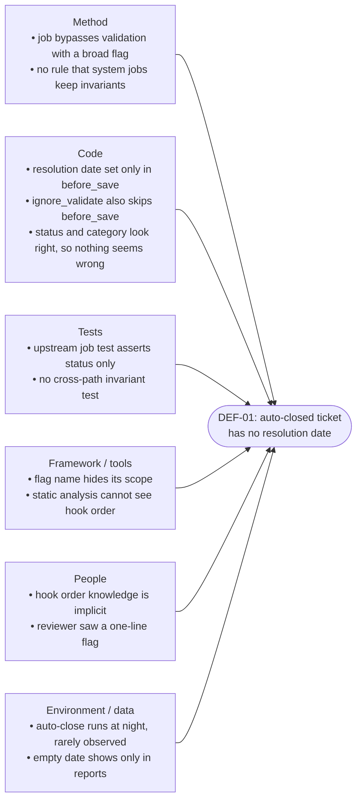
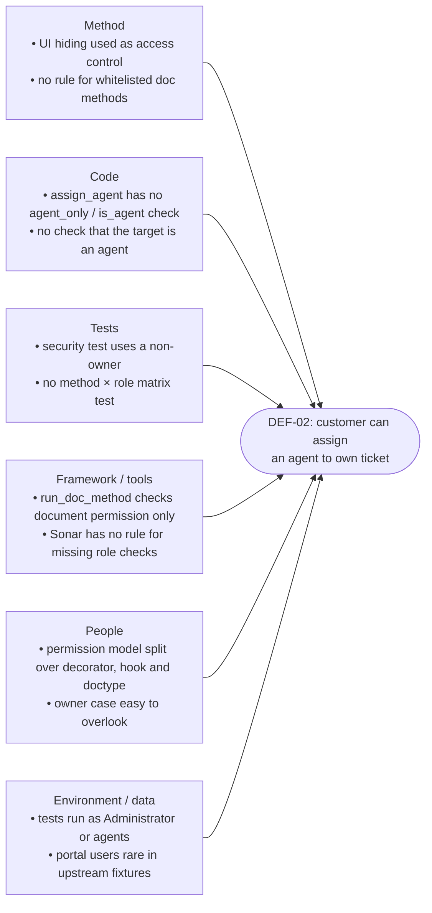

# Root cause analysis of the major defects

Two Major defects analysed with 5 Whys and a fishbone (Ishikawa) diagram.
Each "why" is backed by source or test evidence; inferences are marked.

## RCA-1: DEF-01, an auto-closed ticket gets no resolution date

**Symptom.** The daily job `close_tickets_after_n_days` closes a waiting
ticket (status Closed, category Resolved), but `resolution_date` stays
empty. Closing the same ticket through the API stamps it. Evidence: API test
`test_auto_closed_ticket_gets_a_resolution_date_like_any_closed_ticket`
(strict expected failure).

**Impact.** Resolution analytics and SLA reports bucket by
`resolution_date`, so every auto-closed ticket is missing from them.
With auto-close on (the shipped setting in our seed), that is a whole class
of tickets. Risk PR-02 (16, High).

### 5 Whys

| # | Why? | Because (evidence) |
|---|---|---|
| 1 | Why is the date empty? | `set_resolution_date()`, the only code that stamps the date, did not run when the job saved the ticket. The same status change made through the API, where the full save runs, stamps it. |
| 2 | Why did it not run? | It is called from `HDTicket.before_save` (`hd_ticket.py:110–111`), and the job sets `doc.flags.ignore_validate = True` (`hd_ticket.py:1531`). Frappe's `Document.run_before_save_methods` returns straight after `before_validate` when that flag is set, so it skips **both** `validate` and `before_save` (`frappe/model/document.py:1674–1682`). |
| 3 | Why does the job set that flag? | To close tickets that user-level validation might refuse. The job's comment shows the author wanted the save hooks to run ("SLA will not be applied" with `set_value`) while skipping validation. *(Inferred from the source; the upstream commit history would confirm the intent.)* |
| 4 | Why was the side effect not seen? | The flag's name says "ignore validate", not "ignore before_save". The rule that derives `resolution_date` lives in a hook that the flag also skips, so the coupling is invisible at the call site. The stored ticket shows status Closed and category Resolved, so it looks correctly closed on every screen. |
| 5 | Why did no test catch it? | Upstream's `test_auto_close_respects_inactivity_cutoff_boundary` asserts only `status == "Closed"` (`test_hd_ticket.py:2006–2015`). No test checks the invariant "a ticket in the Resolved category has a resolution date" on **every** path that changes status: UI, API and job. |

**Root cause.** A derived-field invariant (BR3) is enforced in a single hook
that a framework flag silently bypasses, and the tests check the job's
primary effect (status), not the invariant.

### Fishbone

### Actions

| Type | Action | Owner | Verification |
|---|---|---|---|
| Corrective | In the job, replace `flags.ignore_validate` with a narrow flag that only `validate_feedback` honours (`doc.flags.skip_feedback_rule = True`), so `validate` and `before_save` run. | M1 (CI fix PR) | `test_auto_closed_ticket_…` turns from expected failure to pass (strict xfail makes CI fail until the marker is removed); unit tests for BR1 and BR3 and the mutation gate still pass |
| Corrective | Data repair: back-fill `resolution_date` of tickets closed by the job from the time of their "automatically closed the ticket" comment. | M2 | Query: Resolved-category tickets with an empty date = 0 |
| Preventive | Add an invariant test that drives every status-changing path (agent UI, customer close, API, auto-close job) and asserts "category Resolved ⇔ resolution date set". | M2 | Test in `api/`, part of the CI gate |
| Preventive | Review checklist and a Semgrep/Sonar custom rule: any `flags.ignore_validate` in Helpdesk code must state which `before_save` effects it gives up. | M1 | Rule runs in CI; existing uses listed and reviewed |

**Status (18 Nov 2026).** The first corrective action is done:
[PR #38](https://github.com/ibbster05/helpdesk/pull/38) was merged into
`team/sqe-tests` after the required SQE gate passed (run 44295797221), and
Issue #2 is closed. With the fix in place and the strict-xfail marker still
present, the API test reported `XPASS(strict)`, so the gate made the marker's
removal part of the fix. Upstream's 129 `test_hd_ticket` tests gave the same
result with and without the fix (118 pass; the same 11 error in both runs
because the test site has no outgoing mail account).

An alternative first considered, calling `doc.set_resolution_date()` before
`save`, was rejected while writing the fix: at that point `before_validate`
has not yet run, so `status_category` still holds the old value and the date
would be cleared instead of set. The data repair and the two preventive
actions are still open.

## RCA-2: DEF-02, a customer can assign an agent to their own ticket

**Symptom.** Signed in as the ticket's customer, `run_doc_method` with
`assign_agent` returns 200; the agent is assigned and notified. Evidence:
API test `test_customer_cannot_assign_an_agent`, Playwright access check
AC-08 (both pinned as expected failures until the fix). DEF-03 (assigning a ticket to a
customer account) shares the same missing check.

**Impact.** A customer can pick or pester agents, bypass team routing and
trigger assignment notifications. Combined with DEF-03, an agent's
mis-assignment discloses a ticket to another customer. Risk PR-05 (15,
High).

### 5 Whys

| # | Why? | Because (evidence) |
|---|---|---|
| 1 | Why is the customer's request accepted? | `HDTicket.assign_agent` is `@frappe.whitelist()` and has no role check (`hd_ticket.py:483–487`). |
| 2 | Why is a whitelisted method enough? | Frappe's `run_doc_method` (`frappe/handler.py`) checks only that the method is whitelisted and that the caller may load the document (`get_doc(…, check_permission=True)`). |
| 3 | Why may the customer load it? | The customer owns the ticket and needs document permission to read, reply and close it: `has_permission` returns True when the user is the ticket's `contact`, `raised_by` or `owner` (`hd_ticket.py:1352–1357`). |
| 4 | Why was a role check not added? | The customer portal has no assignment control, so the method was written as if only the agent UI calls it: hiding a control was treated as access control. Helpdesk has an `agent_only` decorator (`helpdesk/utils.py:177`) for API functions, but no rule says whitelisted **document methods** need it. *(The "why" of the design is inferred.)* |
| 5 | Why did tests not catch it? | Upstream's `test_security_unauthorized_assign_agent` (`test_hd_ticket.py:1547`) uses a user who does **not** own the ticket, so it is refused by document permission and passes. The case that matters, the ticket's own customer, is not tested. No test enumerates whitelisted methods × roles. |

**Root cause.** Authorisation of whitelisted document methods is delegated
to document permission, which every ticket owner has. There is no
convention, check or test for role-level permission on these methods.

### Fishbone

### Actions

| Type | Action | Owner | Verification |
|---|---|---|---|
| Corrective | Decorate `assign_agent` with `agent_only` (a `PermissionError`, 403, for non-agents) and reject a target that is not an agent (`ValidationError`, 417, "Tickets can only be assigned to agents"), which also fixes DEF-03. | M2 | `test_customer_cannot_assign_an_agent` and `test_ticket_cannot_be_assigned_to_a_non_agent` pass; AC-08 denied; AC-11 (agent allowed) still passes |
| Preventive | Add a test that lists every `@frappe.whitelist()` method on `HDTicket` and calls each as the ticket's own customer; anything not on an explicit allow-list must return 403. | M2, M3 | New methods without a decision fail CI |
| Preventive | Code review checklist: a whitelisted document method states its role rule; access-matrix checks (AC-xx) are added for every new agent action. | All | Checklist in the PR template |

**Status (18 Nov 2026).** The corrective action is done in
[PR #41](https://github.com/ibbster05/helpdesk/pull/41), merged through the
required SQE gate; Issues #3 and #4 are closed.

- **Unit:** a decision table (caller is an agent × target is an agent) covers all
  four combinations (`unit/test_assignment_access.py`). Removing either check,
  or calling `is_agent()` without the target, makes it fail.
- **API and browser:** the two pinned API tests and AC-08 now pass as normal
  tests.
- **Upstream conflict, decided on purpose:** an earlier note said upstream
  allows assignment to non-agent *desk* users. That was wrong. The user in
  upstream's `test_non_agent_flow` (`non_agent@test.com`) is a Website User
  with no roles, the same account type as a customer, so that test asserts
  the behaviour DEF-03 reports. The team chose "agents only", in line with
  `api/ticket.py` ("Tickets can only be assigned to agents") and upstream's
  own TODOs in `get_assigned_agent`. With the fix, that one upstream test
  errors with the new message. The other upstream suites that call
  `assign_agent` (core comments, HD Agent, agent home) give the same results
  as before.

## Lessons for the test process

Both defects passed upstream tests that looked relevant, because those
tests asserted the main effect (status, refusal for a stranger) rather than
the rule's full meaning (invariant on every path, refusal for the owner).
The team's techniques found them because they were derived from the rules:
cross-workflow read-back of the shared record (DEF-01) and an access matrix
by role and ownership (DEF-02).
