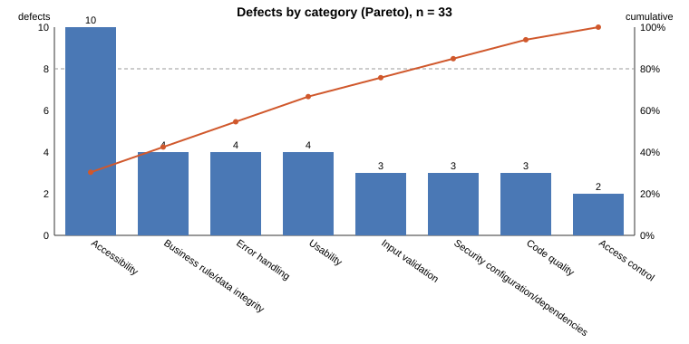

# Defect summary (generated 2026-11-18 by tools/defects_report.py)

## Defect log

| ID | Ref | Title | Category | Severity | Priority | Status | Triage | Risk | Issue |
|---|---|---|---|---|---|---|---|---|---|
| DEF-01 | D-01 | Auto-closed ticket gets no resolution date | Business rule / data integrity | Major | P1 | Open | Fix (CI demo) | PR-02, PR-03 | to file |
| DEF-02 | SEC-01 / W-API-05 | Customer can assign an agent to their own ticket | Access control | Major | P1 | Open | Fix | PR-05 | to file |
| DEF-03 | W-API-06 | Ticket can be assigned to a customer account, which then reads it | Access control | Major | P1 | Open (upstream test_non_agent_flow expects assignment to non-agent desk users; the defect is assignment to a portal customer) | Fix | PR-05 | to file |
| DEF-04 | W-API-07 | Rating an open ticket locks the customer out of closing it | Business rule / data integrity | Minor | P2 | Open | Fix | PR-01, PR-04 | to file |
| DEF-05 | W-API-08 | Agent can overwrite the server-computed resolution date | Business rule / data integrity | Minor | P2 | Open | Fix | PR-02 | to file |
| DEF-06 | W-API-02 | Missing required argument returns 500 with a traceback | Error handling (5xx) | Minor | P3 | Open | Fix | PR-06 | to file |
| DEF-07 | W-API-03 | Numeric feedback_extra returns 500 from the HTML sanitiser | Error handling (5xx) | Minor | P3 | Open | Fix | PR-06 | to file |
| DEF-08 | W-API-09 | Routing a ticket to a team with no members returns 500 (IndexError) | Error handling (5xx) | Minor | P2 | Open | Fix | PR-06 | to file |
| DEF-09 | W-API-01 | A number is accepted and stored as a ticket subject | Input validation | Trivial | P4 | Open | Defer | PR-06 | to file |
| DEF-10 | W-API-04 | Repeating an identical create request makes a second ticket | Input validation | Trivial | P4 | Open | Defer | PR-07 | to file |
| DEF-11 | W-API-10 | A waiting ticket with no messages is never auto-closed | Business rule / data integrity | Trivial | P3 | Open | Defer | PR-03 | to file |
| DEF-12 | OBS (USE_CASES.md) | Description is mandatory in the form but optional through the API | Input validation | Trivial | P4 | Open | Defer | PR-06 | to file |
| DEF-13 | SEC-05 / UX-03 | Article search returns 500 with a stack trace when RediSearch is absent | Error handling (5xx) | Minor | P2 | Open | Fix | PR-06, PR-11 | to file |
| DEF-14 | SEC-02 | Bundled DOMPurify 3.4.8 has published CVEs | Security configuration / dependencies | Major | P2 | Open | Fix | PR-10 | to file |
| DEF-15 | SEC-03 | No Content-Security-Policy header | Security configuration / dependencies | Minor | P3 | Open | Defer | PR-10 | to file |
| DEF-16 | SEC-04 | user_id and full_name cookies are readable by scripts | Security configuration / dependencies | Minor | P4 | Open | Accept (won't fix) | PR-10 | to file |
| DEF-17 | A11Y-01 | Icon-only buttons have no accessible name | Accessibility | Major | P1 | Open (fixed on S2 (customer ticket page) only) | Fix | PR-08 | to file |
| DEF-18 | A11Y-02 | Description editor has no accessible name | Accessibility | Major | P1 | Open | Fix | PR-08 | to file |
| DEF-19 | A11Y-03 | Text below 4.5:1 contrast | Accessibility | Major | P1 | Open (fixed on S2/S3 only) | Fix | PR-08 | to file |
| DEF-20 | A11Y-04 | Message iframes have no title | Accessibility | Major | P1 | Fixed (verified locally, not merged) | Fix | PR-08 | to file |
| DEF-21 | A11Y-05 | ARIA state on a div popover trigger instead of a button | Accessibility | Major | P1 | Open | Fix | PR-08 | to file |
| DEF-22 | A11Y-06 | Filter button's accessible name does not contain its visible text | Accessibility | Minor | P2 | Open | Fix | PR-08 | to file |
| DEF-23 | A11Y-07 (+ A11Y-09) | No main landmark; content outside landmarks | Accessibility | Minor | P2 | Open (fixed on S2 only; A11Y-09 has the same root cause and is not counted separately) | Fix | PR-08 | to file |
| DEF-24 | A11Y-08 | Pages have no level-one heading | Accessibility | Minor | P2 | Open (fixed on S2 only) | Fix | PR-08 | to file |
| DEF-25 | A11Y-10 | Two unnamed nav landmarks | Accessibility | Minor | P2 | Open | Fix | PR-08 | to file |
| DEF-26 | A11Y-11 | No meta description | Accessibility | Trivial | P3 | Fixed (verified locally, not merged) | Fix | PR-08 | to file |
| DEF-27 | A11Y-12 | No source maps for large scripts | Accessibility | Trivial | P4 | Rejected (no user impact; build configuration choice) | Not a defect | - | to file |
| DEF-28 | UX-01 | Customer ticket list hides resolved tickets by default | Usability | Minor | P2 | Open | Fix | PR-11 | to file |
| DEF-29 | UX-02 | Rating dialog does not explain why Submit is unavailable | Usability | Minor | P2 | Open | Fix | PR-08, PR-11 | to file |
| DEF-30 | UX-04 | Fifteen toolbar tab stops between description and Submit | Usability | Trivial | P3 | Open | Defer | PR-08, PR-11 | to file |
| DEF-31 | OBS (USE_CASES.md) | Opening a missing ticket shows the not-found message several times | Usability | Trivial | P4 | Open | Defer | PR-11 | to file |
| DEF-32 | SonarQube python:S8904 | Notification HTML with an img without src raises KeyError | Code quality (static) | Minor | P4 | Open | Defer | PR-06 | to file |
| DEF-33 | SonarQube python:S1763 | Unreachable second return in helpdesk/api/knowledge_base.py | Code quality (static) | Trivial | P4 | Open | Defer | - | to file |
| DEF-34 | SonarQube typescript:S8982/S8984 | v-for lists without a key binding (5 components) | Code quality (static) | Minor | P4 | Open | Defer | - | to file |

## By severity

| Severity | Open | Fixed / closed | Total |
|---|---|---|---|
| Major | 8 | 1 | 9 |
| Minor | 16 | 0 | 16 |
| Trivial | 7 | 1 | 8 |
| **All** | 31 | 2 | 33 |

Excluded: 1 rejected (not a defect).

## Pareto by category

| Category | Defects | % | Cumulative % | Of which Major |
|---|---|---|---|---|
| Accessibility | 10 | 30 | 30 | 5 |
| Business rule / data integrity | 4 | 12 | 42 | 1 |
| Error handling (5xx) | 4 | 12 | 55 | 0 |
| Usability | 4 | 12 | 67 | 0 |
| Input validation | 3 | 9 | 76 | 0 |
| Security configuration / dependencies | 3 | 9 | 85 | 1 |
| Code quality (static) | 3 | 9 | 94 | 0 |
| Access control | 2 | 6 | 100 | 2 |

## GQM metrics

| Metric | Definition | Value |
|---|---|---|
| Defect density, backend | backend defects / Python KLOC (13.9) | 15 / 13.9 = **1.08 per KLOC** |
| Defect density, `hd_ticket.py` | defects rooted in the file / its KLOC (1.25) | 5 / 1.25 = **4.0 per KLOC** |
| Requirements coverage (tested) | requirements with at least one executed test / all | 14 / 14 = **100 %** |
| Requirements coverage (passing) | requirements with no failing test and no open Major defect / all | 9 / 14 = **64 %** |
| Reopen rate | reopenings / defects fixed | 0 / 2 = **0 %** |
