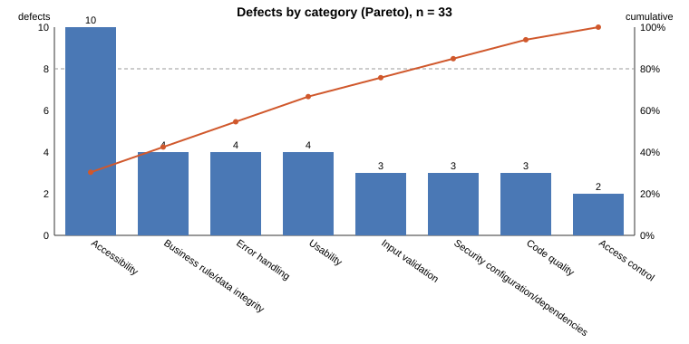

# 1. Summary

The team tested two related ticket workflows of **Frappe Helpdesk** 16.1.0, an
open-source help-desk system built on the Frappe framework:

- **A, raise a ticket:** a customer raises a ticket.
- **B, handle and close a ticket:** an agent handles it, and the customer or a
  daily job closes it.

Testing covered unit, MC/DC, mutation, API with generated data, browser use
cases, usability and accessibility, defensive security, performance and
recovery, and static analysis. A GitHub Actions quality gate on the group's
public fork runs on every pull request; branch protection requires it.

35 defects were logged as GitHub Issues; 34 count as defects (one rejected).
The four Major functional and security defects were fixed through the gate,
each first pinned by a failing test:

| Defect | Problem | Fix PR |
|---|---|---|
| DEF-01 | auto-closed tickets got no resolution date | #38 |
| DEF-02 | a customer could assign an agent to their own ticket | #41 |
| DEF-03 | a ticket could be assigned to another customer, who could then read it | #41 |
| DEF-14 | the bundled HTML sanitiser had published CVEs | #42 |

All 14 requirements and rules now pass. All three release criteria are met
(section 12).

**Recommendation: RELEASE**, with 28 open defects (4 Major, all accessibility)
tracked as known issues.

Evidence for every number in this report is in the repository (`tests/team/`)
or in a GitHub Actions run; links are in section 14. The appendices reproduce
the underlying documents in full.

# 2. System under test and scope

| | |
|---|---|
| Upstream | https://github.com/frappe/helpdesk, licence AGPL-3.0 |
| Baseline | branch `version-16`, commit `e326986329341c803dd4bf094322670ad0591ca5` (Helpdesk 16.1.0), saved as the first commit of the team branch |
| Framework | Frappe v16.56.0 (`49789a1`); telephony app `9447577` (a dependency) |
| Group repository | https://github.com/ibbster05/helpdesk, branch `team/sqe-tests`; team tests in `tests/team/` (upstream tests are not counted) |
| Environment | Windows 11, WSL2 Ubuntu 26.04, Python 3.14.4, Node 24, MariaDB 11.8.6, Redis 8.0.5; site `helpdesk.localhost` |
| Set-up, start, seed, reset | `tests/team/README.md` (Appendix A); `seed.sh seed` creates one agent and two customers with generated passwords, `seed.sh reset` restores the seeded state before each suite |

## 2.1 Workflows and the shared record

| Workflow | Starting condition | User action | Expected outcome |
|---|---|---|---|
| A. Raise a ticket | Customer signed in to the portal | Enters subject and description, submits | Ticket created: Open, Medium, raised by the customer, visible to them and to agents |
| B. Handle and close a ticket | An Open ticket exists | Agent triages, assigns, replies and resolves; customer closes and rates, or the daily job closes it | Status, assignee, resolution date and rating stored per BR1–BR4 |

**Shared record:** the **HD Ticket** row (status, status category,
resolution date, rating, assignee). Workflow A creates it; workflow B reads
and changes it. The daily auto-close job reads its conversation
(Communication rows) and changes its status. That cross-workflow link is
where DEF-01 was found.

## 2.2 Requirements, business rules and roles

| ID | Requirement |
|---|---|
| FR-A1 | Customer raises a ticket with subject and description |
| FR-A2 | New ticket is Open, Medium, raised by the caller |
| FR-A3 | Subject mandatory, at most 140 characters |
| FR-A4 | Ticket visible only to its customer and to agents |
| FR-B1 | Agent assigns a ticket to an agent |
| FR-B2 | Agent sets priority and ticket type |
| FR-B3 | Agent changes status; resolution date follows BR3 |
| FR-B4 | Customer closes own ticket; rating first if resolved and answered |
| FR-B5 | Closed or rated ticket locked for the customer |
| FR-B6 | Waiting ticket auto-closed after N days |

| ID | Business rule | Kind (brief) |
|---|---|---|
| BR1 | A ticket in the configured status is closed when its newest message is older than N days (N−1 stays, N and N+1 close) | boundary / limit |
| BR2 | A ticket cannot be resolved without feedback: rejected only when not rated ∧ Resolved category ∧ caller not an agent ∧ an agent has replied ∧ feedback mandatory | decision with five Boolean conditions (critical module) |
| BR3 | The resolution date is set on entering the Resolved category, cleared on leaving it, and kept on Resolved → Closed | change of state |
| BR4 | A customer may not change a closed or rated ticket, or agent-only fields | decision table |

Roles: **Agent** (desk user) and **HD Customer** (portal user), with
different permissions; the access matrix in section 8 tests both.

Test basis: the Helpdesk source code and documentation. Where they were
silent, a justified assumption is recorded in `e2e/USE_CASES.md` and
`unit/README.md`.

# 3. Area ownership

| Member | Area (examined on) | Use cases |
|---|---|---|
| M1 | Static analysis, white-box unit testing, mutation, CI quality gate | UC-01 Raise a ticket, UC-02 Close and rate |
| M2 | API and integration testing, OpenAPI spec and data generator | UC-03 Triage and assign, UC-04 Resolve and reopen |
| M3 | Use-case automation, usability and accessibility, security, performance | UC-05 Reply to a ticket, UC-06 Find a ticket |
| All | Test management: plan, estimates, risks, defects, progress, completion report; AI-use record | |

Names and roll numbers are on the title page. Note on the commit history: up
to the date of this report, all commits on the team branch were made under
one member's name, from one machine. This is a known deviation (risk PJ-03);
the members' own commits are planned before submission.

# 4. Static analysis and cyclomatic complexity

SonarQube Community Build 26.11 analysed the backend (Python) and frontend
(Vue/TypeScript); full report in Appendix K.

| Metric | Value | What it shows |
|---|---|---|
| Lines of code | 73,337 (Python 13,935; JS/Vue 48,960; TS 10,224) | The frontend is most of the code; the rules under test are in Python |
| Cyclomatic / cognitive complexity | 10,230 / 6,226 | `hd_ticket.py`, which holds BR1–BR3, is the most complex file (cyclomatic 298), supporting the High risk ratings there |
| Duplication | 1.6 % | Low; not a quality risk |
| Bugs / vulnerabilities / code smells | 122 / 8 / 59 | Almost all in the frontend (Python: 2 bugs, 0 vulnerabilities, 1 smell); the true positives were logged (DEF-32 to DEF-34) |
| Ratings | reliability D, security D, maintainability A | All 8 vulnerabilities are in JS/TS code; triaged in Appendix K |
| Technical debt | 252 min | Small for 73 KLOC |
| Coverage | 1.7 % overall, 4.6 % Python | Only the unit suite's coverage is imported; on the rule scope it is 100 % (section 5) |

**Hand-calculated cyclomatic complexity.** For BR1's
`close_tickets_after_n_days` the team drew the control-flow graph (14 nodes,
18 edges). V(G) = E − N + 2 = 18 − 14 + 2 = **6**, confirmed by counting
decisions (5 + 1) and regions (6). SonarQube reports **5**. A calibration
file showed that Sonar's Python rule does not count `except` branches. Five
basis paths are feasible; the sixth is infeasible. For BR2's
`validate_feedback` both give 6. Details in Appendix K.

The SonarQube quality gate ("SQE gate", nine conditions held at the baseline
values) runs in CI on every pull request.

# 5. White-box unit testing, MCC and MC/DC

| | |
|---|---|
| Scope | the server-side business logic of BR1–BR4: `close_tickets_after_n_days`, `HDTicket.validate_feedback`, `is_valid_status_transition`, `set_resolution_date` (in `hd_ticket.py`), all of `customer_edit_controller.py` and `hd_ticket_status.py`. The rest of `hd_ticket.py` (email, SLA wiring, list views) is outside the two workflows' rules |
| Tests | 167 pytest tests, with the framework replaced by test doubles (no site needed) |
| Coverage of the scope | **100 % statements (144) and 100 % branches (68)**, gated by `tools/scoped_coverage.py` in CI |
| Critical module (BR2) | MCC: all 2<super>5</super> = 32 condition combinations; MC/DC: for each condition the pair from the MCC table that differs in that condition only and flips the outcome, 6 rows (n + 1) |
| Also | state-transition tests for BR3 (every allowed change and one disallowed change from each state), boundary tests for BR1, decision tables for BR4 and for the new assignment rule (DEF-02/03 fix) |

# 6. Mutation analysis and CI quality gate

**Mutation.** Cosmic Ray 8.9.0 was run on the rule scope, with three custom
operators based on the business rules:

- `SwapTicketStatus` replaces a status with the one most easily confused
  with it;
- `RevokeAgentExemption` and `GrantAgentExemption` treat an agent as a
  customer, and a customer as an agent.

| | Run 1 | Run 2 | After the fixes |
|---|---|---|---|
| Mutants in scope | 237 | 237 | 238 |
| Mutation score | 86.9 % | 97.0 % | 97.1 % |

All 31 survivors of run 1 were analysed. 24 were killed by new or sharper
tests (weak test data or missing tests). 7 are equivalent, each with a
reason (Appendix L). All 18 custom-operator mutants were killed in run 1.

**CI quality gate** (`.github/workflows/sqe-quality-gate.yml`). It runs on
every pull request into `team/sqe-tests`, and branch protection requires
its final "SQE gate" check, for admins too. There are no escape hatches
(`continue-on-error` or `|| true`).

| Job | Fails when | Threshold justification |
|---|---|---|
| Unit + coverage | a test fails or rule-scope coverage < 100 % | the brief's 100 % target; reached and held since week 1 |
| Mutation | score < 95 % | measured 97.0–97.1 %; all killable mutants killed, so 95 % leaves room only for the equivalent ones |
| SonarQube | "SQE gate" fails: reliability or security worse than D, maintainability worse than A, more bugs (122) or vulnerabilities (8) than the baseline, unreviewed hotspots, duplication > 3 %, failing imported tests | a fresh server each run has no "new code" period, so counts are held at the baseline (no worse than today) |
| API + browser on a live site | any test fails, or a pinned weakness (strict xfail) unexpectedly passes | forces a fix PR to remove the pin it resolves |

**Blocked pull request** ([PR #37](https://github.com/ibbster05/helpdesk/pull/37)).
This was a deliberately faulty change: it restamped the resolution date on
every status change, which breaks BR3. Four jobs caught it:

- unit: `test_switching_between_two_resolved_statuses_keeps_the_original_date`;
- API: `test_agent_may_make_every_status_change[Closed-Resolved]`;
- mutation: Cosmic Ray refused a failing baseline;
- SonarQube: its job reruns the unit tests.

GitHub showed the PR as BLOCKED, and it was closed unmerged.

**Documented fix** ([PR #38](https://github.com/ibbster05/helpdesk/pull/38), DEF-01):

- *Before:* the API test was pinned as a strict expected failure.
- *With the fix:* it reported `XPASS(strict)`, so the gate forced the
  marker's removal in the same PR.
- *After:* the PR was green and merged.

PRs #41, #42, #43 and #44 followed the same path.

# 7. API and integration testing; automated test data

| | |
|---|---|
| Contract | `api/openapi.yaml`: the four operations of the workflows (create, get, update ticket; assign agent) |
| Generator | `api/generate_testdata.py` reads the spec and produces equivalence classes (one invalid value per case) and 3-point boundary values (just below, at, just above every limit): 58 cases, which the API tests consume |
| Constraint change | two constraints changed in the spec and regenerated; the effect on the cases is shown in `api/evidence/` (`demo_constraint_change.sh`) |
| Tests | 132 (pytest + Requests against the running site): generated EP/BVA, rule rejections, every status transition plus disallowed ones, repeated requests (no duplicates), read-back of the shared record after success and rejection, recovery R1/R2, DEF-01 data repair |
| Result (CI) | **121 pass, 11 pinned weaknesses** (strict expected failures, Appendix J) |
| API coverage criteria | `test_zz_api_coverage.py` measures, from the requests actually sent: every operation called; every documented response code observed; every input with at least one valid and one invalid case; every enum value sent |

Cross-workflow checks: the auto-close job (BR1) changes the status that BR3
reacts to. The test that reads the ticket back after the job is how DEF-01
was found.

# 8. Use cases, usability, accessibility, security, performance

**Use cases.** Six use cases, two per member (`e2e/USE_CASES.md`,
Appendix M). Each has a main flow, at least two alternative and two
exception flows, preconditions and postconditions. All **33 flows** are
automated in Playwright (Chromium) and assert the result shown and the
stored postconditions. One flow pins DEF-35 (a frontend race found by CI)
as an expected failure.

**Usability.** Two task tests, one per workflow.

- **Task A (raise a ticket):** first submits a subject the rule rejects,
  checks that the message explains what to correct, corrects it and checks
  the confirmation.
- **Task B (close and rate):** driven by keyboard only. It checks that focus
  reaches the rating, the reason and Submit in the expected order, and that
  the keyboard submits the form.

**Accessibility** (Lighthouse + axe-core on five key screens; Appendix N).
Issues found by both tools are counted once. The customer ticket page had
the lowest score and was fixed (PR #43):

| Customer ticket page | Before | After (re-scanned on the merged code) |
|---|---|---|
| Lighthouse accessibility | 82 | 100 |
| axe rules violated / elements | 6 / 36 | 0 / 0 |

**Security** (defensive, local copy only; Appendix O).

- **Access matrix:** 13 decisions verified by Playwright across both roles
  and anonymous users, including allowed and denied actions. 12 of 13
  matched on the baseline; AC-08 (customer assigns an agent) was DEF-02.
  All 13 match since PR #41.
- **Automated controls:** six (session cookie, CSRF, sign-out, sign-in
  errors, server-side role checks, sanitiser version).
- **ZAP passive scan:** run while the Playwright suites drove both
  workflows.
- **Dependency audit:** pip-audit of 178 Python packages found 10 advisories
  in 3 packages (bleach, gitpython, pdfkit). The first two are not on the
  workflows' request path; pdfkit's is mitigated by the options Frappe always
  sets. ZAP's library check found DOMPurify 3.4.8 (DEF-14), fixed in PR #42;
  ZAP then reported 0 vulnerable libraries.

**Performance and recovery** (Appendix P). The operation measured is an agent
opening a ticket (`get_one`), with k6. The limits were set before the first
run: p95 ≤ 300 ms at 1 user and ≤ 800 ms at 5 users, and < 1 % unexpected
failures.

| Users | Run | Requests/s | p95 ms | Failures | Within limits |
|---|---|---|---|---|---|
| 1 | 1 / 2 | 1.9 / 1.9 | 16.1 / 17.5 | 0 % | yes |
| 5 | 1 / 2 | 9.7 / 9.7 | 27.7 / 25.8 | 0 % | yes |

The recovery tests make a dependency unavailable after the row is written
but before the commit:

- **R1** creates a ticket;
- **R2** resolves a ticket.

Each test checks what was persisted, restores the dependency, retries, and
checks the final state with no duplicates. Both pass. A deliberately broken
handler makes both fail.

# 9. Test management

Full documents in Appendices B–H. In brief:

- **Test plan**: scope, approach by risk level, roles, environment, test
  data, three-week schedule, entry, exit, suspension and resumption criteria;
  version 1.3 with change log.
- **Estimation**: three-point estimates for 13 areas, expected 141.7
  person-hours (SD 7.6). The actual-effort column is filled from each
  member's own time log (Appendix C). The estimates for areas already done
  were not blind, which the document states.
- **Risk register**: 11 product and 5 project risks on a 5 × 5 matrix. The
  risk level chose the technique and depth, for example MCC + MC/DC and
  mutation for the High-rated BR2. Each risk has a residual rating after
  testing.
- **Exit criteria** (six, measurable; EC-1 to EC-3 tied to the highest risks)
  and **release criteria** RC-1 = EC-2 (functional), RC-2 = EC-3 (security),
  RC-3 = EC-4 (performance). All six exit criteria are met.
- **Traceability**: every requirement and rule traced to tests at each level
  and to defects. Requirements coverage is 14 / 14 tested and 14 / 14
  passing (64 % passing on the baseline).

# 10. Defects, root cause analysis, Pareto

All defects are GitHub Issues on the fork, labelled with severity, priority,
status, triage decision and category (Issues #2–#36). The log is
`management/defects.yaml` (Appendix I).

| Severity | Open | Fixed / closed | Total |
|---|---|---|---|
| Major | 4 | 5 | 9 |
| Minor | 17 | 0 | 17 |
| Trivial | 7 | 1 | 8 |
| **All** | **28** | **6** | **34** |

**Pareto by category.** Accessibility accounts for 29 %, then business rule,
error handling and usability at 12 % each. By count accessibility dominates,
partly because each axe rule is logged separately. By severity, the Majors
that blocked release were in business rules, access control and a
vulnerable library, and all four are fixed.

**Root cause analysis** (5 Whys and fishbone, with corrective and preventive
actions; Appendix F) for the two Major defects:

- **RCA-1, DEF-01.** The job used `flags.ignore_validate` to get past the
  feedback rule. Frappe's flag also skips `before_save`, where the
  resolution date is set, and upstream's test only checked the status.
  - *Corrective:* a narrow flag (PR #38), plus a tested data-repair tool
    (PR #44).
  - *Preventive:* a cross-path invariant test, and a review rule for
    `ignore_validate`.
- **RCA-2, DEF-02.** `assign_agent` was whitelisted with no role check, and
  `run_doc_method` checks only document permission, which the ticket's
  owner has. Upstream's security test used a non-owner.
  - *Corrective:* `agent_only` plus a target check (PR #41).
  - *Preventive:* a test calling every whitelisted method as the owner.

Every API, accessibility, security and performance finding is listed in
the appendices with its root cause, severity, risk and fix:

- **Root cause:** in the activity reports (Appendices J, N, O);
- **Severity, risk and status:** in the defect log (Appendix I);
- **Performance:** no finding; all runs were within the limits.

# 11. Monitoring and GQM

**Goal:** assess the quality of the two ticket workflows, from the point of
view of the release decision.

| Question | Metric | Value | Reading |
|---|---|---|---|
| How defect-prone is the code under test? | Defect density, backend | 15 / 13.9 KLOC = 1.08 per KLOC | a lower bound: most defects come from targeted tests, not a uniform sweep |
| | Defect density, `hd_ticket.py` | 5 / 1.25 KLOC = 4.0 per KLOC | about four times the backend average, in Sonar's most complex file, which supports its High risks |
| How completely are the requirements tested? | Requirements coverage | 14 / 14 tested, 14 / 14 passing | 64 % passing on the baseline, 86 % after PR #38, 100 % after PR #41 |
| Are fixes holding? | Reopen rate | 0 / 6 | every CI run re-tests the gated fixes; still little data |

The weekly progress report (Appendix G) shows progress against the plan,
deviations and control actions. The reports for weeks 2 and 3 are added by
the team as the project continues.

# 12. Release decision

| Criterion | Target | Actual | Met? |
|---|---|---|---|
| RC-1 (functional) Open Major/Critical defects against BR1–BR4 | 0 | 0 (DEF-01 closed by PR #38) | **Yes** |
| RC-2 (security) Access decisions as expected; open Major access-control defects | 13 / 13; 0 | 13 / 13; 0 (DEF-02/03 closed by PR #41) | **Yes** |
| RC-3 (performance) p95 at 5 users; unexpected failures | ≤ 800 ms; < 1 % | 27.7 / 25.8 ms; 0 % | **Yes** |

**Decision: RELEASE.**

- The highest risks (PR-02 resolution date, PR-05 access control) went from
  High to Low through fixes that were first pinned by failing tests, then
  merged only after the required gate passed.
- The two conditions that were attached to release are met: DEF-14 is
  upgraded, and the DEF-01 data repair is done with a tested tool. On this
  site the tool found 0 affected tickets.

Known issues released with the system, tracked as Issues:

- the accessibility P1 issues on the screens not yet fixed (DEF-17, -18,
  -19, -21);
- DEF-35 (a closed ticket briefly shown as open on a slow load);
- the remaining minor defects.

One behaviour change must be stated if the fixes are offered upstream:
tickets can now be assigned only to agents, and upstream's
`test_non_agent_flow` asserts the opposite. The recommendation would revert
to HOLD if the gate turned red on `team/sqe-tests`.

# 13. AI-use record

Generative AI was used for most of this project, and is disclosed in full in
Appendix Q.

- **Tool:** Claude Code (Anthropic), with the models Claude Fable 5.2 and
  later Claude Opus 5.5.
- **What it did:** it worked as an agent on the team's machine and
  repository. It wrote the tests, scripts, configuration and documents, ran
  the tools, and opened the Issues and pull requests through a member's
  account.
- **Per area:** the record gives the purpose, the output and what was
  verified, with evidence.
- **Mistakes:** it lists 17 mistakes the AI made, and how evidence caught
  each.
- **Prompts:** every prompt is kept verbatim (`ai/PROMPTS.md`, Appendix R).
- **Team checks:** the "checked by the team" columns and the members'
  sign-off are completed by the members themselves.
- **One product decision** was made by the team, not the AI: the DEF-03
  rule that tickets go to agents only.

# 14. Evidence links

| Evidence | Link |
|---|---|
| Group repository and team branch | https://github.com/ibbster05/helpdesk/tree/team/sqe-tests |
| Defect Issues (#2–#36) | https://github.com/ibbster05/helpdesk/issues?q=is%3Aissue |
| CI gate added (PR #1), green run | https://github.com/ibbster05/helpdesk/pull/1, https://github.com/ibbster05/helpdesk/actions/runs/44293330442 |
| Blocked PR #37 and its red run | https://github.com/ibbster05/helpdesk/pull/37, https://github.com/ibbster05/helpdesk/actions/runs/44295784190 |
| Documented fix PR #38 (DEF-01) and its run | https://github.com/ibbster05/helpdesk/pull/38, https://github.com/ibbster05/helpdesk/actions/runs/44295797221 |
| Fix PR #41 (DEF-02/03) | https://github.com/ibbster05/helpdesk/pull/41, https://github.com/ibbster05/helpdesk/actions/runs/44360687578 |
| Fix PR #42 (DEF-14) | https://github.com/ibbster05/helpdesk/pull/42, https://github.com/ibbster05/helpdesk/actions/runs/44367798932 |
| Accessibility fix PR #43 | https://github.com/ibbster05/helpdesk/pull/43, https://github.com/ibbster05/helpdesk/actions/runs/44374685970 |
| Data repair PR #44 | https://github.com/ibbster05/helpdesk/pull/44, https://github.com/ibbster05/helpdesk/actions/runs/44379272620 |
| All tests, scripts, data and reports | `tests/team/` in the repository (layout in Appendix A) |
| Raw evidence | `tests/team/*/evidence/`: Sonar JSON, mutation reports, generated data, Lighthouse/axe reports before and after, ZAP before and after, pip-audit, k6 raw output, data-repair reports |
