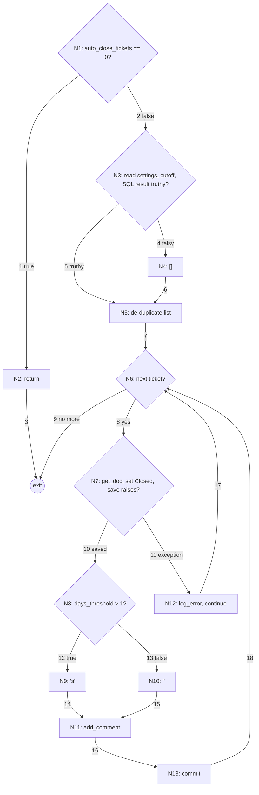

# Hand-calculated cyclomatic complexity

Function: **`close_tickets_after_n_days()`** in
`helpdesk/helpdesk/doctype/hd_ticket/hd_ticket.py` (lines 1492–1545 at
baseline e326986). It implements **BR1, auto-close after N days**, the
boundary rule, and is the scheduled job behind workflow B's "no reply"
path. A second, smaller function (`HDTicket.validate_feedback`, BR2, the
critical module) is worked in section 4 as a cross-check.

## 1. Source with node labels

```python
def close_tickets_after_n_days():
    if frappe.db.get_single_value("HD Settings", "auto_close_tickets") == 0:   # N1  decision d1
        return                                                                 # N2
    status, days_threshold = frappe.db.get_value(...)                          # N3
    days_threshold = cint(days_threshold)                                      # N3
    inactivity_cutoff = add_to_date(now_datetime(), days=-days_threshold)      # N3
    tickets_to_close = (frappe.db.sql(...)                                     # N3  decision d2 (`or`)
                        or [])                                                 # N4
    tickets_to_close = list(set(tickets_to_close))                             # N5
    for ticket in tickets_to_close:                                            # N6  decision d3
        doc = frappe.get_doc("HD Ticket", ticket)                              # N7
        doc.status = "Closed"                                                  # N7
        doc.flags.ignore_validate = True                                       # N7
        try:                                                                   # N7  decision d4 (except)
            doc.save(ignore_permissions=True)                                  # N7
            doc.add_comment("Info",
                f"... {days_threshold} day{'s' if days_threshold > 1 else ''} ...")  # N8 decision d5, N9 / N10, N11
        except Exception as e:
            frappe.log_error(...)                                              # N12
            continue                                                           # N12
        frappe.db.commit()                                                     # N13
                                                                               # X   exit
```

Modelling choices (stated so the count can be checked):

* Straight-line statements with no branch are merged into one node (N3, N7).
* `a or b` is a short-circuit decision: `b` (the `[]`) only runs when `a` is
  falsy, so it gets its own node N4.
* The `try` body is modelled with one exception edge, from the `save` node
  N7 to the handler N12: one `except` clause adds one decision. (An
  exception from `add_comment` reaches the same handler; drawing it as a
  second edge would count the same decision twice.)
* The conditional expression inside the f-string is a decision (N8 → N9 `'s'`
  or N10 `''`, joining at N11, the `add_comment` call).

## 2. Control-flow graph



## 3. Calculation (three methods)

| Method | Working | V(G) |
|---|---|---|
| Edges and nodes | E = 18 edges (numbered above), N = 14 nodes (N1–N13 and exit X); V(G) = E − N + 2P = 18 − 14 + 2·1 | **6** |
| Decision points | d1 `if`, d2 `or`, d3 `for`, d4 `except`, d5 conditional expression: 5 binary decisions; V(G) = 5 + 1 | **6** |
| Regions | Bounded regions of the planar graph: (1) N1-N2-X-N6-N5-N3 via the early return, (2) N3-N4-N5, (3) N6-N7-N12 loop through the handler, (4) N7-N8-N11-N13-N6 loop, (5) N8-N9-N11-N10; plus the outer region: 5 + 1 | **6** |

So the basis set has six linearly independent paths. Five of them are
feasible and between them traverse all 18 edges:

| Path | Edges | Situation | Test that drives it (`unit/test_br1_auto_close.py`) |
|---|---|---|---|
| P1 | 1, 3 | auto-close switched off | `test_job_does_nothing_when_auto_close_is_switched_off` |
| P2 | 2, 4, 6, 7, 9 | switched on, query returns no rows (`[]` or `None`) | `test_nothing_due_closes_nothing`, `test_no_rows_returned_as_none_is_handled` |
| P3 | 2, 5, 7, 8, 10, 12, 14, 16, 18, 9 | one due ticket, N > 1 ("days") | `test_each_due_ticket_is_closed_saved_commented_and_committed` |
| P4 | 2, 5, 7, 8, 10, 13, 15, 16, 18, 9 | N ≤ 1 ("day") | `test_comment_wording_at_the_singular_plural_boundary` (N = 0, 1, 2) |
| P5 | 2, 5, 7, 8, 11, 17, 9 | save raises, error logged, loop continues | `test_a_ticket_that_fails_to_save_is_logged_and_the_rest_still_close` |
| P6 | 2, 5, 7, 9 | query returns rows but the loop does not run | **infeasible** |

P6 is the sixth independent path the formula predicts, but it cannot
execute: d2 and d3 are correlated. `frappe.db.sql(..., pluck="name")`
returns a list, so the left side of `or` is truthy only when it has at
least one row, and then the loop must run at least once. V(G) is an upper
bound on the paths needed for branch coverage; here 5 feasible paths cover
every edge.

Note on tools: coverage.py reports only **4 branches** for this function
(the `if` and the `for`, `evidence/unit_run.txt`). It does not treat the
`or []` or the conditional expression as branches, so its "100 % branch
coverage" would not notice if P2's `None` case or P4's singular wording were
untested. The CFG makes those decisions visible, and the team has a test for
each.

## 4. Cross-check: `HDTicket.validate_feedback` (BR2)

```python
def validate_feedback(self):
    is_feedback_mandatory = frappe.get_cached_value(...)   # N1 (+ condition A)
    if (self.feedback_rating                                 # A   N1
        or self.status_category != "Resolved"                # B   N2
        or is_agent()                                        # C   N3
        or not self.has_agent_replied                        # D   N4
        or not is_feedback_mandatory):                       # E   N5
        return                                               # N6
    frappe.throw(...)                                        # N7
                                                             # X
```

With short-circuit evaluation each condition is its own decision node: A–D
each go to `return` when true or to the next condition when false; E goes to
`return` or `throw`.

* Nodes: N1–N5, return, throw, exit = 8. Edges: 2 out of each of the 5
  conditions = 10, plus return→exit and throw→exit = 12.
  V(G) = 12 − 8 + 2 = **6**.
* Decisions: 1 `if` + 4 `or` operators = 5; V(G) = 5 + 1 = **6**.

Six basis paths: "A true", "A false, B true", … "A–D false, E true" (five
ways to return) and "all false" (throw). These are rows of the MCC/MC/DC
tables in `unit/test_br2_feedback_rule.py`, which need 6 MC/DC cases; 32
MCC rows exercise every combination.

## 5. Comparison with SonarQube

SonarQube Community Build 26.11, project `helpdesk-complexity`, rule
`python:FunctionComplexity` (S1541) with its threshold lowered to 1 so that
it reports the exact value of every function (`evidence/summary.md`,
`evidence/complexity/issues.json`).

| Function | By hand | SonarQube | Agree? |
|---|---|---|---|
| `close_tickets_after_n_days` (line 1492) | 6 | **5** | no, by 1 |
| `HDTicket.validate_feedback` (line 408) | 6 | 6 | yes |
| `HDTicket.is_valid_status_transition` (947), quick count: 2 `if` + 2 `or` + 1 | 5 | 5 | yes |
| `HDTicket.set_resolution_date` (956), quick count: 3 `if` + 1 `and` + 1 | 5 | 5 | yes |

**Why `close_tickets_after_n_days` differs.** To find out which construct
Sonar does not count, we analysed a calibration file with one construct per
function (`calibration/cc_calibration.py`, results in
`calibration/calibration.md`):

| Construct | Textbook | SonarQube 26.11 (Python) |
|---|---|---|
| `if`, `while`, `for`, `and`, `or`, conditional expression | +1 each | +1 each |
| `except` clause | +1 each | **+0** (one or two handlers: still 1) |
| `elif` | +1 | **+0** (`if`/`elif` chain reported as 2, not 3) |
| comprehension with `if` | +2 (`for` and `if`) | +1 |

Sonar's count for the function is therefore 1 (function) + `if` + `or` +
`for` + conditional expression = 5. The difference is exactly the `except`
handler, which our CFG counts because the handler is a real alternative
path: when `save` raises, control goes to `log_error` and back to the loop
instead of to `commit` (path P5, which needs its own test). For test design
the hand value 6 is the one to use; Sonar's 5 would under-state the paths by
one.

**Cognitive complexity** (rule S3776, same probe): `close_tickets_after_n_days`
scores 7: `if` +1, `or` +1, `for` +1, conditional expression +2 and `except`
+2 (each +1 for being nested inside the loop). Cognitive complexity does
count the `except`. `validate_feedback` scores only 2 (`if` +1, and the
chain of `or` +1 because a sequence of the same operator counts once), although
its cyclomatic value is 6: the rule has many paths but reads as one flat
condition. That is why the team tested it with MCC and MC/DC tables rather
than by paths alone.
